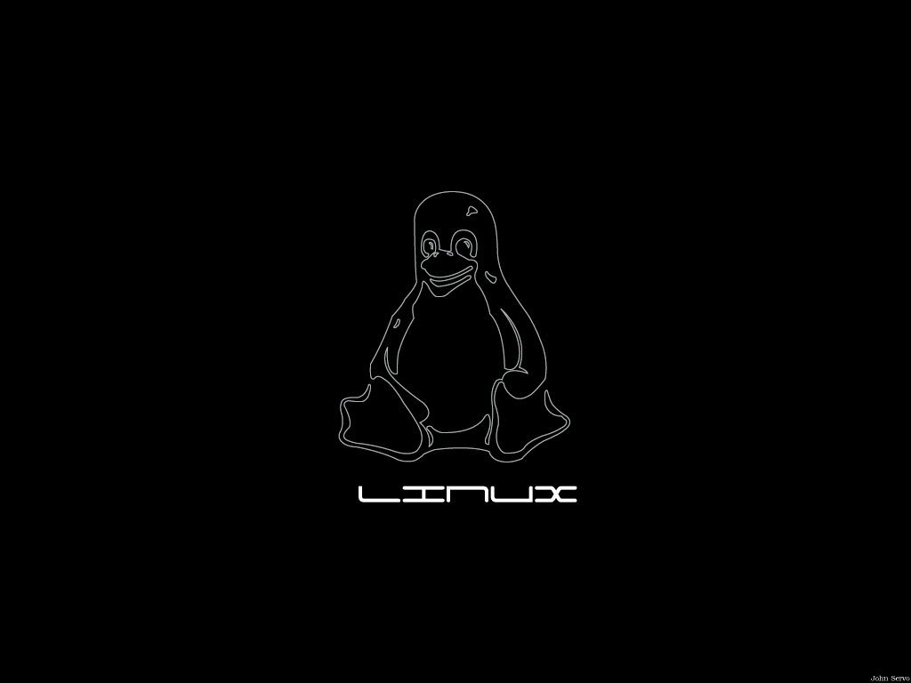
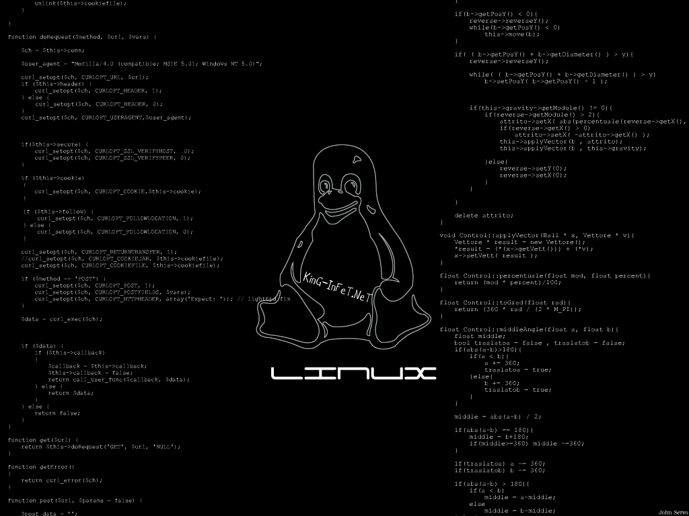
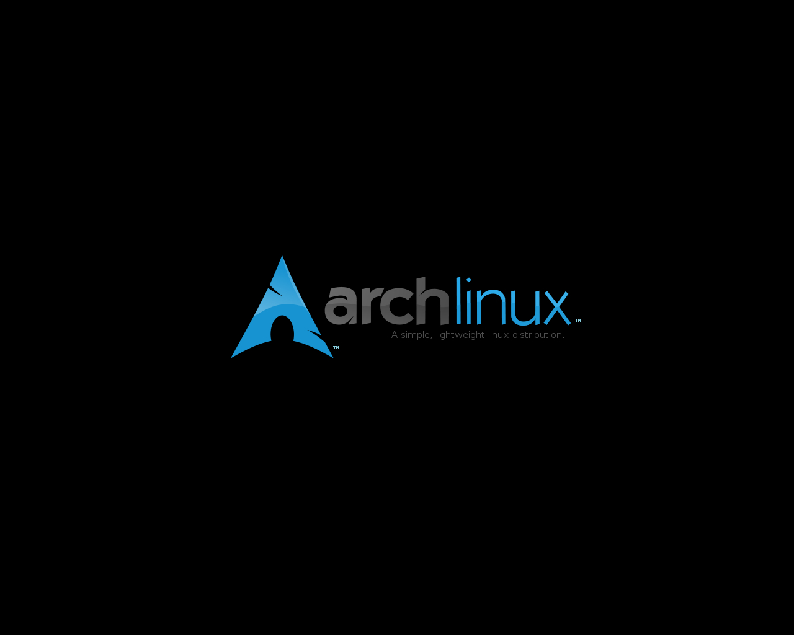
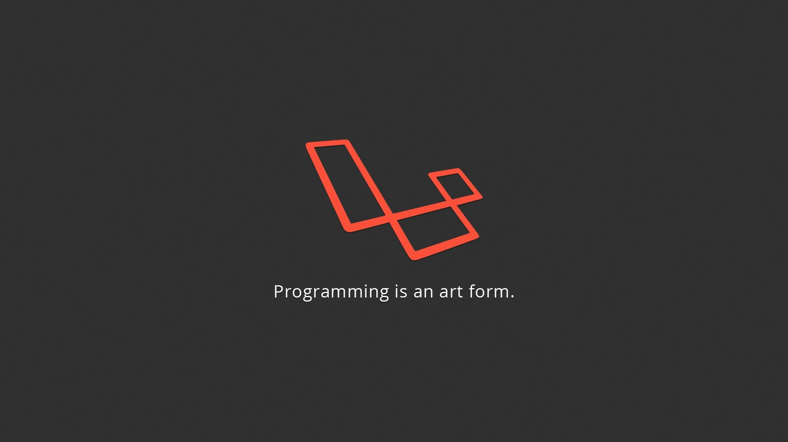

<div align="center">

# .::My Stuff::.

**Personal dotfiles and desktop rice**

<sub>From Arch Linux + Fluxbox (2012) to Ubuntu + GNOME (today). Always dark, always red.</sub>

<br><br>


<br>






</div>

---

## 🗂️ What's inside

| Path | Goes to | What it is |
|---|---|---|
| [`bashrc`](bashrc) | `~/.bashrc` | Two-line, git-aware red prompt, Tux welcome banner, aliases, dev toolchain |
| [`conkyrc`](conkyrc) | `~/.conkyrc` | Transparent system monitor docked in the top-right corner |
| [`DarkRedHack/`](DarkRedHack) | GNOME Shell + GTK3/4 | Dark, squared, red-accented "hacker" theme for the whole GNOME desktop |
| [`vimrc`](vimrc) | `~/.vimrc` | Vim tuned for coding: omni-completion, ctags, rich status line, F-key shortcuts |
| [`Xdefaults`](Xdefaults) | `~/.Xdefaults` | xterm and urxvt: black background, transparency, clickable URLs |
| [`xinitrc`](xinitrc) | `~/.xinitrc` | Starts Fluxbox inside a D-Bus session |
| [`fluxbox/`](fluxbox) | `~/.fluxbox/` | Window manager: menu, keys, startup, DarkRedArch and DarkBlueArch styles |
| [`irssi/`](irssi) | `~/.irssi/` | IRC client: 11 networks preconfigured and the *darkblood* theme |
| [`moc/`](moc) | `~/.moc/` | Console music player: *darkblood* theme and custom keymap |
| [`images/`](images) | `~/img/` | Wallpapers and avatar |

---

## 🖥️ The modern desk: Ubuntu 24.04 + GNOME 46

### 🐚 Bash

Every new terminal greets you with Tux, the distro info and a two-line prompt that shows the current git branch:

```text
 _________________________
< Welcome Vincenzo Luongo >
 -------------------------
   \
    \
        .--.
       |o_o |
       |:_/ |
      //   \ \
     (|     | )
    /'\_   _/`\
    \___)=(___/

Distributor ID: Ubuntu
Description:    Ubuntu 24.04 LTS
Release:        24.04
Codename:       noble

user @ host - [master]
~/my_stuff
└─ $ ▶
```

- **Prompt**: user in red, host in cyan, git branch in green, working directory on its own line, then the `└─ $ ▶` arrow.
- **Aliases**: `ll`, `la`, `l`, colored `ls`/`grep`, `python` → `python3`, `alert` for desktop notifications after long commands.
- **AI coding shortcuts**: `clauded` (Claude Code) and `codexd` (Codex CLI), both in unattended mode.
- **`myip`**: prints your public IP address.
- **Dev toolchain on the PATH**: Android SDK (tools + platform-tools), Gradle 7.6, Oracle JDK 23, nvm for Node.js.

### 📊 Conky

A transparent, borderless panel pinned to the top-right corner, refreshed every 3 seconds (Conky 1.10+ syntax):

| Section | What it shows |
|---|---|
| System | Distro, kernel, architecture, hostname, local IP and public IP (refreshed every 5 minutes) |
| CPU | Model, usage bar for each of the 8 threads, per-core frequency |
| Memory | RAM and swap usage with bars |
| Disk | Root partition free space, NVMe read/write speed |
| Processes | Top 8 by CPU and top 8 by memory |
| System info | Uptime, load average, battery status with bar |
| Sensors | CPU package and per-core temperatures, NVMe temperature, fan speed |
| Network | Ethernet and VPN speed, WiFi SSID, signal, bitrate and IP, each shown only while connected |

> [!TIP]
> Interface, disk and battery names are tied to this machine (`enxd0c0bf31fbb0`, `wlp0s20f3`, `surfshark_wg`, `nvme0n1`, `BAT0`).
> Sensors are picked by driver name (`coretemp`, `nvme`, `dell_smm`), so they survive reboots.
> Find yours with `ip -br link`, `lsblk`, `ls /sys/class/power_supply` and `cat /sys/class/hwmon/hwmon*/name`, then replace them in `conkyrc`.

### 🩸 DarkRedHack

A dark, squared, red-accented GNOME theme with a "hacker" look, built on top of Yaru-dark. It covers the top bar and menus, GTK3 apps and GTK4/libadwaita apps.

- Near-black surfaces, crisp 1px lines instead of soft shadows, corners capped at 2px.
- Red line under the top bar and every title bar, red toggles, red markers on selected items, red text cursor.
- JetBrains Mono for the clock, the top bar and window titles.
- Snap, Flatpak and Electron apps stay dark too.


```bash
cd DarkRedHack && ./install.sh     # install and activate
./uninstall.sh                     # restore the original look
```

Full guide, customization and troubleshooting: [DarkRedHack/README.md](DarkRedHack/README.md) (🇮🇹 [Italian version](DarkRedHack/README.it.md)).

---

## 🕹️ The classic setup: Arch Linux + Fluxbox

### 🪟 Fluxbox

- **Boot**: `xinitrc` starts Fluxbox through `dbus-launch`; `startup` loads the keymap, sets the wallpaper with `feh`, then launches Conky, XAMPP and the notification daemon.
- **Styles**: two hand-made themes, **DarkRedArch** and **DarkBlueArch** (KinG-InFeT, June 2012), with custom pixmaps for every title bar button and the pixel font *kroeger 05_55*.
- **Layout**: full-width toolbar at the bottom with workspace switcher, window list, system tray and clock; click-to-focus, opaque window moves, edge snapping.
- **Root menu** (right click on the desktop): terminals, network (IRC, FTP, torrent, IM, browsers), IDEs, Android development, graphics, video and audio editors, a full games section, LibreOffice, multimedia, a wallpaper picker and one-click editing of every config file.

| Shortcut | Action |
|---|---|
| `Alt` + `F1` / `F2` / `F3` | urxvt / Thunar / Firefox |
| `Alt` + `F5` / `F6` | gedit / FileZilla |
| `Alt` + `F4` / `F9` / `F10` / `F11` | Close / minimize / maximize / fullscreen |
| `Alt` + `Tab` | Next window on the current workspace |
| `Win` + `Tab` | Next tab in the window group |
| `Alt` + left / right drag | Move / resize a window |
| Scroll on desktop or toolbar | Switch workspace |
| Middle drag on a title bar | Group windows as tabs |

### 💻 Terminal

`Xdefaults` gives xterm and urxvt the same look: black background, light grey text, 18px fixed font, 85×25 window, 35% shaded transparency, blinking cursor, no scrollbar. In urxvt a click on a URL opens it in Firefox.

### 📝 Vim

*BlackLight's damn cool .vimrc, modded by KinG-InFeT.*

- Syntax highlighting, 256 colors, line numbers, smart indentation, incremental smart-case search.
- Status line with file format, type, ASCII/HEX of the char under the cursor, position and length; it changes color in insert mode.
- Omni-completion for C/C++, Python, Java, JavaScript, HTML, CSS, XML and PHP, plus ctags for many libraries.

| Key | Action | Key | Action |
|---|---|---|---|
| `F3` | Dictionary lookup of the word | `T` | NERDTree file explorer |
| `F4` | Tag list | `B` | `make` |
| `F5` | Reload the file | `C` | Generate ctags |
| `F7` / `F8` | Previous / next compile error | `W` / `q` / `Q` | Save / quit / force quit |
| `F9` / `F10` | Compile / run | `t` | Open a file in a new tab |
| `F12` | Vim Commander | Arrow keys | Resize splits |

### 💬 irssi & 🎵 MOC

- **irssi**: IRCnet, EFNet, Undernet, DALnet, QuakeNet, OFTC, GameSurge, Rizon and more ready to `/connect`, with the dark red *darkblood* theme.
- **MOC** (`mocp`): matching *darkblood* theme, custom keymap, JACK → ALSA → OSS output, repeat and auto-next, lyrics, synced playlists.

---

## 🚀 Install

Pick only what you need. Back up your own files first.

```bash
git clone https://github.com/KinG-InFeT/my_stuff.git ~/my_stuff && cd ~/my_stuff

# Dotfiles (linked, so a git pull updates them)
for f in bashrc conkyrc vimrc Xdefaults xinitrc; do
  ln -sf "$PWD/$f" ~/.$f
done

# GNOME theme (Ubuntu 24.04 / GNOME 46)
(cd DarkRedHack && ./install.sh)

# Classic apps
mkdir -p ~/.irssi ~/.moc/themes ~/.fluxbox/styles ~/img
cp irssi/* ~/.irssi/
cp moc/config moc/moc_keymap_marslo ~/.moc/ && cp moc/theme/darkblood ~/.moc/themes/
cp fluxbox/init fluxbox/keys fluxbox/menu fluxbox/startup ~/.fluxbox/
cp -r fluxbox/style/* ~/.fluxbox/styles/
cp images/* ~/img/
```

> [!NOTE]
> The Fluxbox files were written for a root session, so they point to `/root/...`.
> Adapt them to your home with `sed -i "s|/root|$HOME|g" ~/.fluxbox/{init,startup,menu}`.

---

## 🧭 Distro timeline

<div align="center">


→

→

→

→


</div>

| When | Distro | Desktop | Milestone |
|---|---|---|---|
| Early days | **Slackware** | | Where the Linux journey began |
| 2012 | **Gentoo** | Fluxbox | First commit of this repo: everything compiled from source, first Fluxbox styles |
| 2012 | **Arch Linux** | Fluxbox | DarkRedArch and DarkBlueArch styles, custom root menu, urxvt, irssi, MOC |
| 2017 | **Fedora Workstation** | | Conky ported to Fedora, multi-monitor fix |
| 2024 → today | **Ubuntu 24.04 LTS** | GNOME 46 | DarkRedHack theme, laptop-aware Conky, git-aware prompt, AI coding CLIs |

<sub>Years come from this repository's commit history.</sub>

---

## 🧰 Software I use

### Today, on Ubuntu

| Category | Software |
|---|---|
| Desktop | GNOME 46 + DarkRedHack, Conky, Warp terminal |
| Browsers | Google Chrome, Firefox, Chromium |
| Editors & IDEs | VS Code, Sublime Text, Vim, Android Studio, Godot |
| AI & CLI | Claude Code, GitHub CLI, AWS CLI, ngrok, uv |
| Languages & runtimes | PHP 8.4 + Composer, Node.js via nvm (pnpm, Yarn), Python 3.12, Oracle JDK 23 + Gradle |
| Local stack | Apache, MySQL 8, Redis, Postman, Beekeeper Studio |
| Communication | Slack, Thunderbird, Telegram, Discord |
| Remote & network | Surfshark VPN, AnyDesk, TeamViewer, Remmina, FileZilla, nmap |
| Virtualization | VirtualBox, QEMU, LXD, Wine |
| Media & creative | Spotify, VLC, Blender, FreeCAD, LibreOffice |
| Gaming | Steam, itch.io, PCSX2, TORCS |
| Utilities | htop, bpytop, neofetch, cowsay, yt-dlp, qBittorrent, JDownloader 2 |

<details>
<summary>📜 <b>Back in the day: Gentoo and Arch Linux era</b></summary>

<br>

| Category | Software |
|---|---|
| Desktop | Fluxbox or MATE, Conky, feh |
| Terminal & editors | urxvt, Vim, gedit, Geany, Notepadqq |
| Development | Eclipse, Android Studio |
| Internet | Firefox, Thunderbird (MinTrayR), Pidgin, irssi, FileZilla, Deluge, JDownloader |
| Files & media | Thunar, Ristretto, Evince, MPlayer |

Classic Firefox add-ons: Adblock Plus, BugMeNot, ColorZilla, Download Statusbar, Easy YouTube Video Downloader, Firebug, Password Exporter, Stylish, Wappalyzer.

</details>

<details>
<summary>📁 <b>Repository layout</b></summary>

```text
my_stuff/
├── bashrc              Bash: prompt, aliases, toolchain
├── conkyrc             Conky system monitor
├── vimrc               Vim
├── Xdefaults           xterm / urxvt
├── xinitrc             X session → Fluxbox
├── DarkRedHack/        GNOME Shell + GTK theme (install.sh / uninstall.sh)
├── fluxbox/
│   ├── init            WM settings
│   ├── keys            keyboard and mouse bindings
│   ├── menu            root menu
│   ├── startup         autostart script
│   └── style/          DarkRedArch, DarkBlueArch
├── irssi/              config + darkblood theme
├── moc/                config, keymap, darkblood theme
└── images/             wallpapers + avatar
```

</details>

---

<div align="center">

Made by **KinG-InFeT** · [Vincenzo Luongo](https://luongovincenzo.it)

<sub>Fluxbox styles are released under CC BY-NC-SA, as stated in their headers.</sub>

</div>
